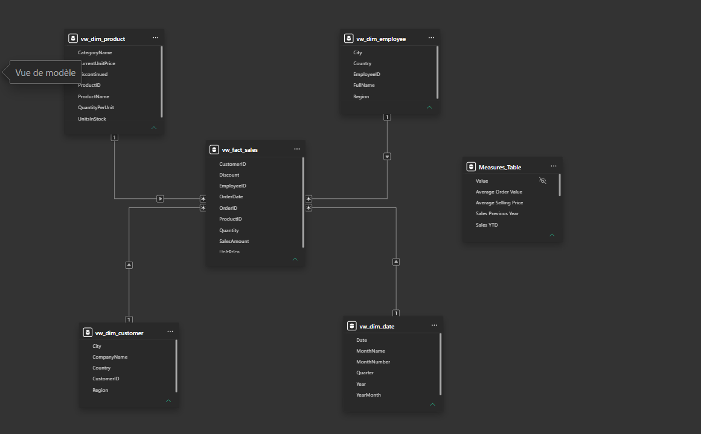
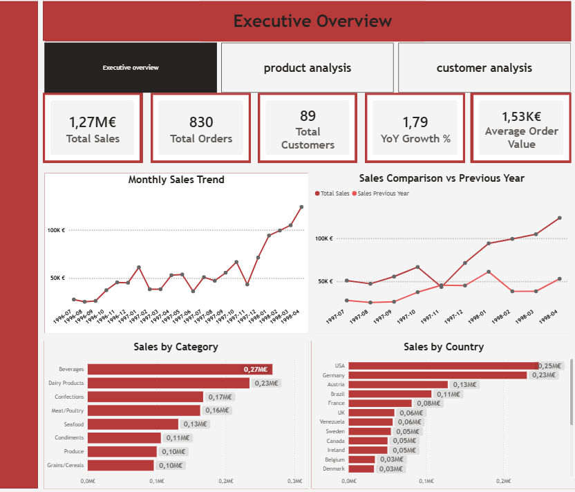
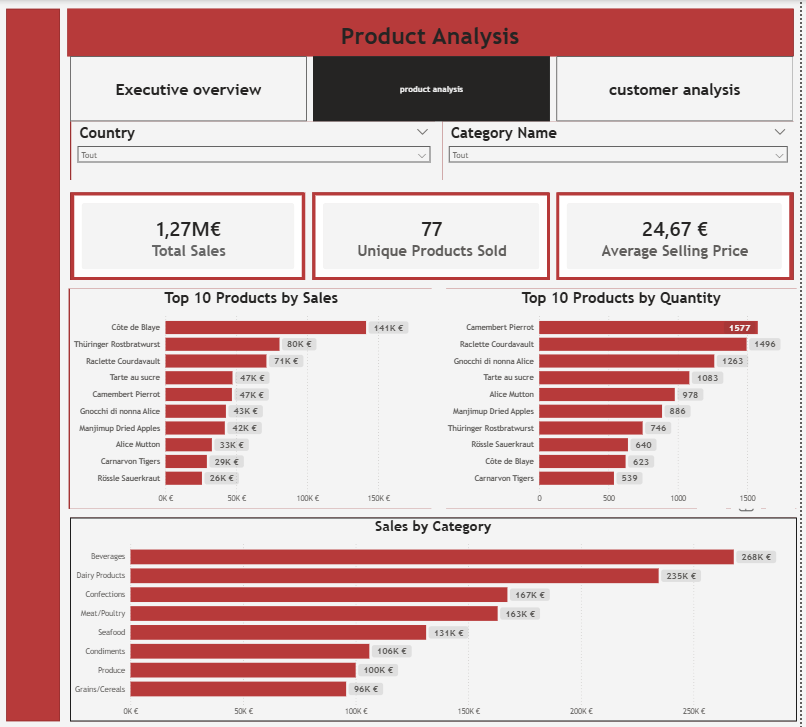
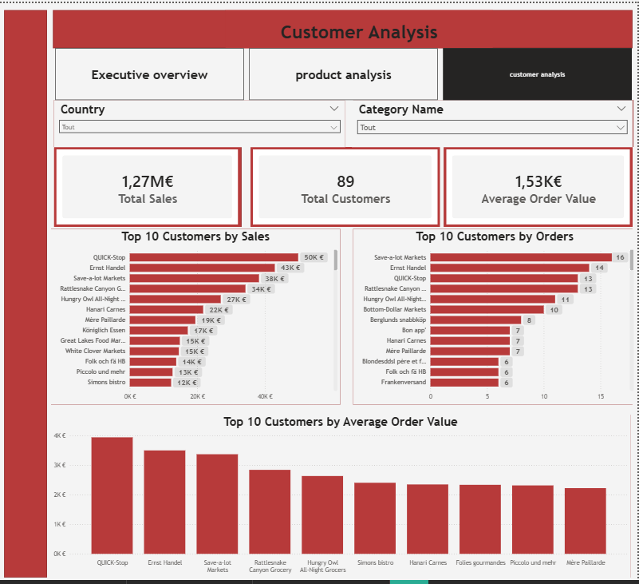

# 📊 Northwind Sales Dashboard | SQL Server & Power BI

## 📌 Project Overview

This project is a Business Intelligence solution developed using **SQL Server** and **Power BI**, based on the Northwind sales database.

The objective is to transform sales data into an analytical model and create interactive dashboards to explore:

- Overall sales performance
- Product performance
- Customer purchasing behavior
- Sales trends and year-over-year comparisons

## 🛠️ Tools & Technologies

- **SQL Server** — Data preparation, transformation, and modeling
- **SQL** — Views, joins, and analytical queries
- **Power BI** — Data visualization and interactive reporting
- **DAX** — Business KPIs and time intelligence calculations

## 🧱 Data Modeling

A star schema was implemented using SQL Server views to organize the data for analysis in Power BI.

**Fact table:**
- `vw_fact_sales`

**Dimension tables:**
- `vw_dim_product`
- `vw_dim_customer`
- `vw_dim_employee`
- `vw_dim_date`

This dimensional model simplifies relationships between tables and supports efficient analytical reporting.

### Star Schema



## 📊 Power BI Dashboard

The report contains three interactive analytical pages.

### 1. Executive Overview

Provides an overview of business performance through:

- Total Sales
- Total Orders
- Total Customers
- Sales YoY Growth
- Monthly sales trends
- Sales compared with the previous year
- Sales by category and country



### 2. Product Analysis

Explores product performance through:

- Top 10 products by sales
- Top 10 products by quantity sold
- Sales distribution by category
- Interactive country and category filters



### 3. Customer Analysis

Analyzes customer behavior through:

- Top 10 customers by sales
- Top 10 customers by number of orders
- Top 10 customers by average order value
- Customer segmentation insights



## 📈 Key Insights

The analysis highlights several business patterns:

- Some products generate high revenue despite relatively low sales volumes.
- Customers who place frequent orders are not necessarily the highest-spending customers.
- A relatively small group of customers contributes a significant share of total sales.

## 📁 Repository Structure

```text
northwind-sales-dashboard/
├── images/
│   ├── overview.png
│   ├── product.png
│   ├── customer.png
│   └── star_schema.png
├── README.md
└── Other project files
```

## 🚀 How to Explore the Project

1. Review the SQL scripts and dimensional model, where available in the repository.
2. Open the Power BI `.pbix` file in Power BI Desktop, if included.
3. Configure the required SQL Server data connection before refreshing.
4. Explore the interactive dashboards using the available slicers.

## 🎯 Project Purpose

This project demonstrates practical skills in SQL, relational data modeling, DAX, and Power BI dashboard development.

It was developed as part of a Data Analyst / Business Intelligence portfolio.
